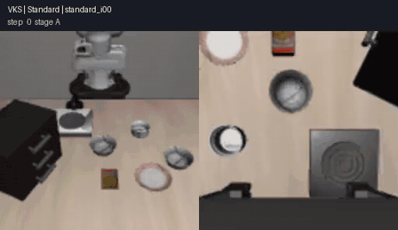
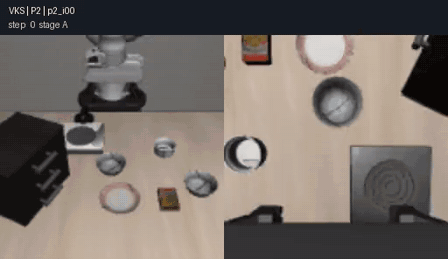
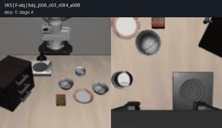
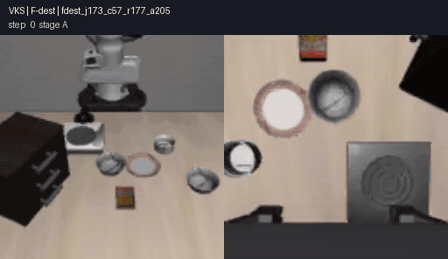
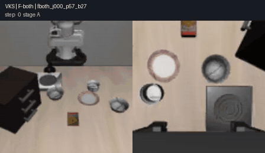
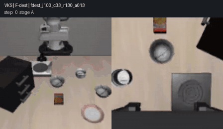

# Visual Keypoint Servoing on LIBERO-PRO

A pick-and-place policy built from a small learned keypoint detector and a
geometric stage controller. It is evaluated on the LIBERO-Spatial task
*"pick up the black bowl from table center and place it on the plate"* under
the LIBERO-PRO position swap (P2) and under layouts where the bowl and/or
the plate are moved 6–18 cm from where they were in the demonstrations.

The policy sees only the two camera images (agentview and wrist, 128×128) and
proprioception (end-effector pose, gripper fingers). Object poses from the
simulator are never used.

## Rollouts

Left half of each clip: agentview camera. Right half: wrist camera. These are
exactly the images the policy receives.

<table>
<tr>
<td align="center"><br><sub>Standard layout</sub></td>
<td align="center"><br><sub>P2: plate and cookie box swapped</sub></td>
</tr>
<tr>
<td align="center"><br><sub>Bowl moved 8.4 cm</sub></td>
<td align="center"><br><sub>Plate moved 17.7 cm</sub></td>
</tr>
<tr>
<td align="center"><br><sub>Bowl and plate both moved</sub></td>
<td align="center"><br><sub>Failure: plate moved 13 cm, bowl released off-centre</sub></td>
</tr>
</table>

The full-resolution mp4 files are in [`results/videos/`](results/videos).

## Results

Success within 220 steps, one episode per test layout (95% Wilson intervals).

| Test family | What changes | Episodes | Success | 95% CI |
|---|---|---|---|---|
| Standard | original LIBERO-Spatial init states 0–29 | 30 | **100.0%** | 88.6–100 |
| P2 | LIBERO-PRO swap: plate and cookie box exchange places | 30 | **100.0%** | 88.6–100 |
| F-obj | source bowl moved 6–15 cm | 53 | **100.0%** | 93.2–100 |
| F-dest | plate moved 6–18 cm | 69 | **78.3%** | 67.2–86.4 |
| F-both | bowl and plate both moved | 32 | **90.6%** | 75.8–96.8 |

All 18 failures have the plate moved 11 cm or more. In almost all of them the
bowl is released about 25 mm from the plate centre, which is too far for the
success check. The same controller driven by ground-truth object poses gets
60/69 on F-dest and 31/32 on F-both, so 9 of the 15 F-dest failures happen
even with perfect perception. They are limits of the controller.

Detector accuracy on renders of the 5 held-out demonstrations, after fusing
both cameras: bowl median 0.40 mm (p95 6.8 mm), plate median 0.60 mm
(p95 3.6 mm). One policy step (both detectors, perception and controller)
takes about 4 ms on an RTX 4060 Ti.

## Method

```
agentview image ─► K-Net ─┐                                 ┌─► bowl xyz ─┐
                          ├─► peaks ─► back-project ─► fuse ┤             ├─► stage controller ─► OSC action
wrist image ─────► K-Net ─┘     (known plane heights,       └─► plate xyz ┘          ▲
                                 wrist pose from eef obs)                  gripper width ─► phase (reach / carry)
```

**1. Keypoint detection.** One K-Net per camera: a CenterNet-style
fully convolutional network (ResNet encoder to stride 8, two upsampling blocks,
CoordConv input, 1.19 M parameters). It predicts a 64×64 heatmap for two
classes (black bowl, plate), a sub-pixel offset and a visibility logit. Peaks
are found by 3×3 non-maximum suppression with confidence ≥ 0.5.

Training images are re-renders of the 45 training demonstrations, with the
plate, the second bowl, the cookie box and the ramekin placed at random. Some
are placed under the wrist camera, and in some the cookie box sits on the
original plate spot, as P2 does. There are 36,741 images per camera, with labels
taken from the simulator. Loss is focal + L1 offset + visibility BCE, with
photometric and shift augmentation.

**2. 3D estimates.** Each peak is back-projected onto the known height of the
bowl rim or plate rim. The agentview camera is fixed. The wrist camera pose comes
from `robot0_eef_pos/quat` and a fixed hand→camera transform. The *source*
bowl is the one nearest the table-centre region, as the task names it. It
stays locked once the gripper is within 6 cm. Per camera, the detection nearest
the current track (4 cm gate) is kept. The two cameras are combined by
inverse-variance weighting. The variances were measured on held-out renders,
per object, camera and phase.

**3. Stage controller.** The task is a fixed sequence of stages, each defined
relative to the current object estimate:

| Stage | Target |
|---|---|
| A | above the grasp pose (bowl + grasp offset + h_g) |
| Hb | hover until 3 bowl estimates agree within 3 mm, then freeze the estimate |
| B, C | descend to the grasp pose, close the gripper |
| D | lift by h_lift |
| E | above the release pose (plate + release offset + h_r) |
| Hp | hover and freeze the plate estimate |
| F, G | descend to the release pose, open the gripper |
| R | retreat 8 cm upwards |

The grasp/release offsets, orientations and clearance heights are medians over
the training demonstrations (`configs/vks.json`). Motion is a speed-limited
P-controller in position and orientation. Reach vs. carry is inferred from the
gripper command and finger width alone. The controller restarts if the bowl is
dropped, the bowl estimate jumps by more than 4 cm, or the gripper closes on
nothing. It releases anyway if it stalls just above the plate for 60 steps.

## Code structure

```
vks_method/
├── vks/
│   ├── detector.py      K-Net model, target encoding, peak decoding, focal loss, Detector wrapper
│   ├── geometry.py      camera calibration, pixel → 3D plane back-projection, quaternion helpers
│   ├── perception.py    source-bowl selector, gating and two-camera fusion
│   ├── controller.py    tracking laws, phase tracker, estimate filter/latching, stage controller
│   └── policy.py        VKSPolicy: observation dict → 7-D action; builds everything from the config
├── evaluate.py          runs the policy on the test layouts (optionally records videos)
├── train_detector.py    trains one K-Net from rendered HDF5 shards
├── summarize.py         per-family success rate and Wilson CI from episodes.jsonl
├── configs/vks.json     calibration, fusion variances, selector and controller parameters
├── checkpoints/         trained K-Net weights (agentview: epoch 14, wrist: epoch 30)
├── data/                214 test layouts (metadata + MuJoCo states)
├── assets/              BDDL task files for the standard scene and the P2 scene
├── results/             summary.csv, per-episode results, videos (mp4) and GIFs
└── tests/               unit tests (detector, geometry, perception, controller, policy)
```

## Usage

```bash
./setup.sh                 # venv, PyTorch, LIBERO-PRO
source env.sh
pytest                     # unit tests

python evaluate.py --family P2 --n 5                       # first 5 P2 layouts
python evaluate.py                                         # all 214 layouts (~15 min)
python evaluate.py --ids standard_i00 p2_i00 --video       # with videos in runs/videos/
python summarize.py runs/episodes.jsonl
```

Results are deterministic. Re-running a layout gives the same success step as
in `results/episodes/`.

Retraining the detector needs the rendered training shards (about 2.6 GB, not
included):

```bash
python train_detector.py --camera agentview --train renders/train/*.h5 --dev renders/dev/*.h5 --out runs/knet_agentview
```

## Notes

- Simulator: LIBERO / robosuite 1.4 with MuJoCo 2.3.7, OSC_POSE control at 20 Hz.
- Every episode resets with `env.seed(0)`, loads the layout state, then takes
  10 steps with the gripper open before the policy starts.
- The method is specific to this one task: object classes, plane heights and
  grasp offsets are fixed for the bowl and plate.

## Credits

- LIBERO: Liu et al., 2023, https://github.com/Lifelong-Robot-Learning/LIBERO.
- LIBERO-PRO: https://github.com/Zxy-MLlab/LIBERO-PRO. The task files in `assets/`
  and the initial states the test layouts are built from come from it.
- The K-Net heatmap design follows CenterNet (Zhou et al., *Objects as Points*, 2019).

## License

Released under the [MIT License](LICENSE). The LIBERO-PRO task files and the
initial states derived from them are under CC BY 4.0.
